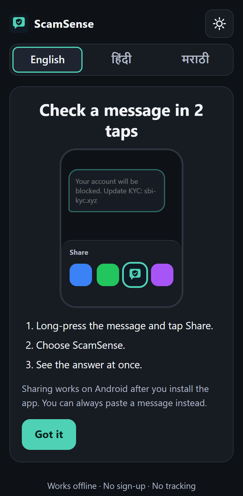
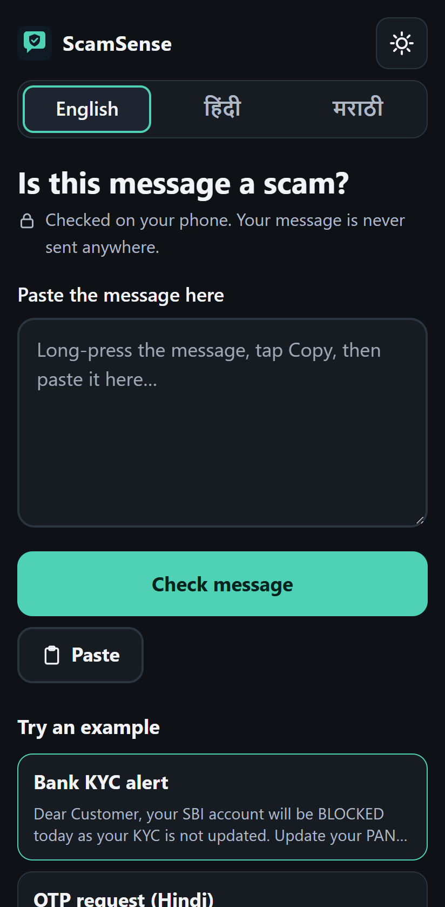
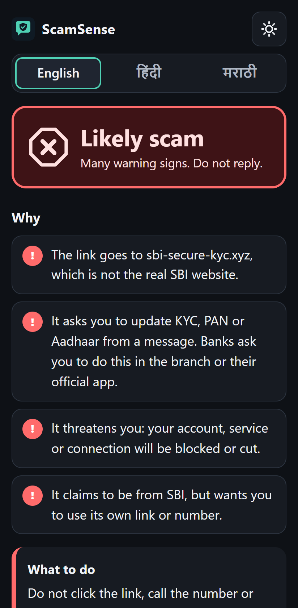
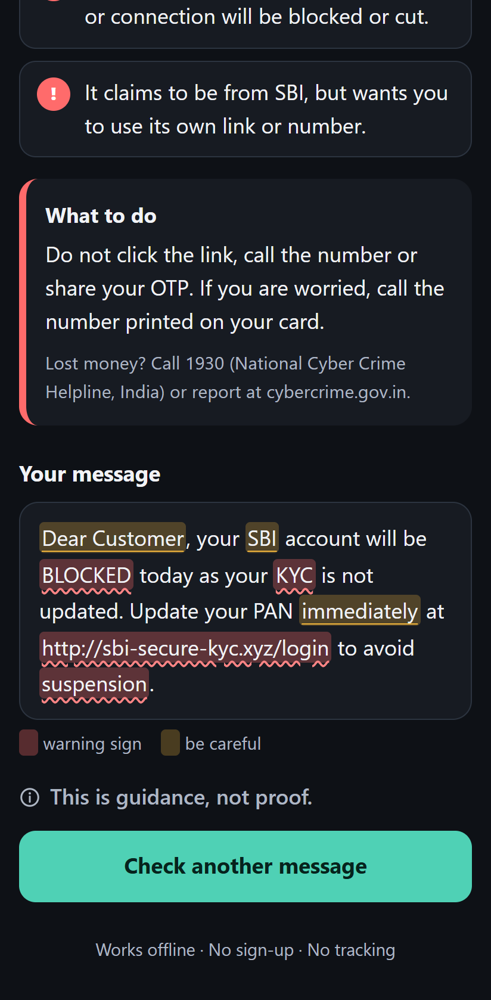
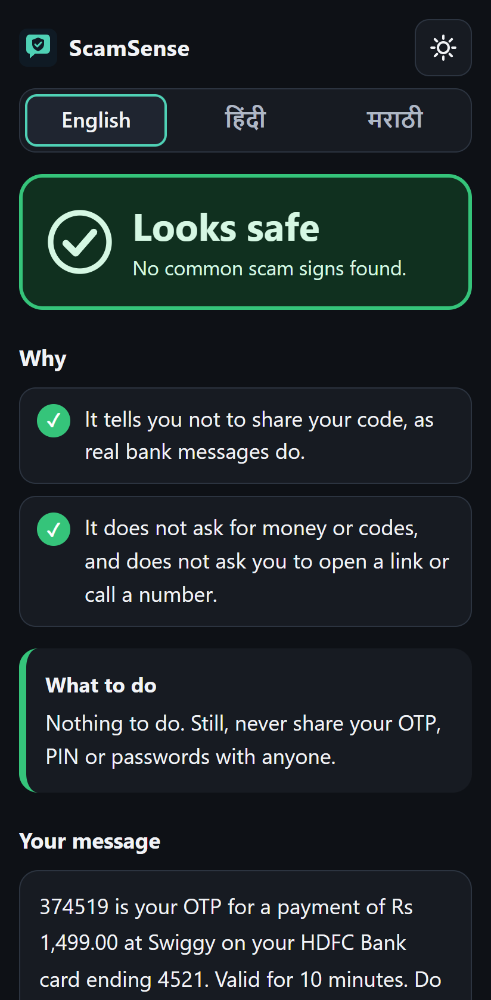
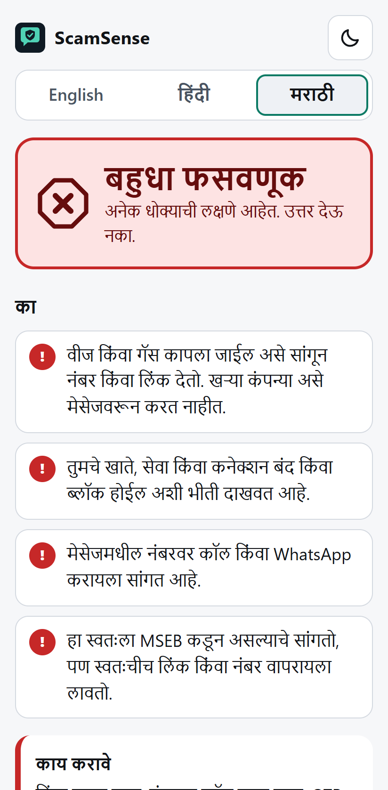
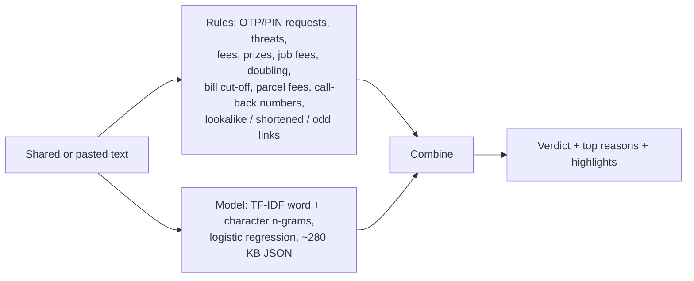

# ScamSense

**Live app:** https://omkar210404.github.io/Scam-Sense/ (open on Android Chrome and install it to use Share → ScamSense)

A privacy-first checker for suspicious SMS, WhatsApp and email messages. On Android you long-press a message, tap **Share**, pick **ScamSense**, and you get a verdict at once: **Looks safe**, **Suspicious** or **Likely scam**, with 2 to 4 reasons in plain English, Hindi or Marathi, the warning words highlighted, and a short "what to do" line. You can also paste a message, or try one of the 6 built-in examples.

Everything runs on the phone. There is no backend, no account and no analytics. The message is never sent, logged or stored. The built page carries a Content-Security-Policy that only allows requests to its own origin, and the app works offline once it has been opened.

## Screenshots

Real screenshots of the live app in a phone-sized browser (Pixel 7 size), using the built-in examples.

<table>
  <tr>
    <td align="center"><br><sub>First run: the 2-tap share flow</sub></td>
    <td align="center"><br><sub>Paste box and 6 examples</sub></td>
    <td align="center"><br><sub>Fake SBI KYC: Likely scam</sub></td>
  </tr>
  <tr>
    <td align="center"><br><sub>What to do + highlighted words</sub></td>
    <td align="center"><br><sub>Real bank OTP: Looks safe</sub></td>
    <td align="center"><br><sub>Marathi, light mode</sub></td>
  </tr>
</table>

## How it decides



1. **Rules** ([src/engine.ts](src/engine.ts)) look for patterns in English, Hindi, Marathi and romanised Hinglish: requests for an OTP, PIN, CVV or password (a "do not share your OTP" line does *not* count), "enter your PIN to receive money", screen-sharing apps, urgency and threats, fee or money requests, lottery wins, job offers that charge a fee, guaranteed or doubled returns, electricity/gas cut-off threats, parcel fees, phone numbers to call or WhatsApp, and a claimed bank or company. Links are checked separately: a brand name inside a different domain (`sbi-secure-kyc.xyz`, `paypa1-secure.com`), URL shorteners, IP-address links, punycode and unusual TLDs. Each rule has a weight.
2. **Model** ([train.py](train.py)): TF-IDF over word 1–2 grams and character 2–4 grams, then logistic regression. It is exported to one JSON file (281 KB) and run in plain TypeScript, with no ML runtime. The JS port matches scikit-learn to within 0.00003 on every test message.
3. **Combine**: each rule and the model raise the risk independently (noisy-OR). The model adds nothing below 0.35 probability, and counts half on Devanagari text. "Likely scam" needs at least one concrete rule hit, so a red verdict always has a reason you can check.

## Measured results

Measured with `npm run eval`, which runs the full app (rules + model, exactly as in the browser) on a held-out test split. That split was never used for training, for choosing the model's C, or for tuning the rules (the rules were tuned on a separate validation split).

Data: the UCI SMS Spam Collection (5,574 messages, 5,159 after removing exact duplicates so that no copy sits in both train and test) plus 142 synthetic messages. Each source is split 70 / 10 / 20 (train / validation / test), stratified, seed 42. "Flagged" means Suspicious or Likely scam.

| Test set | Messages | Spam/scam | Accuracy | Precision | Recall |
|---|---|---|---|---|---|
| UCI SMS Spam Collection, flagged | 1,032 | 129 | 99.2% | 98.4% | 95.3% |
| UCI, "Likely scam" only | 1,032 | 129 | 90.0% | 100.0% | 20.2% |
| Synthetic (written by me), flagged | 29 | 15 | 100% | 100% | 100% |

The model alone (threshold 0.5, same UCI test split) scores accuracy 99.2%, precision 98.4%, recall 95.3%.

How to read these numbers:
- Most UCI "spam" is 2011-era UK marketing (ringtones, "txt STOP"), not fraud. So the app mostly marks it **Suspicious**, and only 20% reach **Likely scam**. That is intended: a red verdict needs a concrete scam sign.
- The synthetic test set is tiny, and I wrote it in the same style as the training examples and the rules. Treat 100% there as a sanity check, not as evidence that the app works on real Indian scam messages. There is no public labelled set of Hindi or Marathi scam messages that I could test on.

## Honest limits

- **Share target**: works on **Android with Chrome (or another Chromium browser) after installing the PWA**. It does **not** work on iOS: Safari does not support Web Share Target, so on iPhone you paste the message. It also needs HTTPS (or localhost).
- **The model has a sender bias**: in UCI, normal messages almost never contain phone numbers or links. So "call me on 98xxxxxxxx" from a friend can come out **Suspicious**.
- **Little Indian-language data**: the Hindi, Marathi and Hinglish knowledge comes mostly from hand-written rules and about 100 synthetic training messages. New wording, other languages (Tamil, Bengali and so on) and scams with no link, number or money request will be missed.
- The rules only see the text. They cannot check the real sender, look up links, or know if a number belongs to a bank. A scam written to look ordinary will pass, and a real message can be flagged. **This is guidance, not proof.**

## Run it

```bash
# train the model (downloads the UCI data once into data/raw/, writes src/model.json)
python -m venv .venv && .venv/Scripts/activate        # macOS/Linux: source .venv/bin/activate
pip install -r requirements.txt
python train.py

# the app
npm install
npm run dev          # http://localhost:5173 (no service worker in dev)
npm run build        # production build in dist/
npm run preview      # serves dist/ at http://localhost:4173 with the service worker and share target
npm run eval         # full-app metrics on the test split (needs train.py to have run)
```

## Deploy (HTTPS is required for install and share)

- **Vercel**: import the repo, framework preset *Vite*, build `npm run build`, output `dist`. Done; Vercel serves HTTPS.
- **GitHub Pages** (used for the live app): [.github/workflows/deploy.yml](.github/workflows/deploy.yml) builds and publishes `dist/` on every push to `main`. In the repo settings, set Pages → Source to *GitHub Actions*. All paths are relative, so the `/Scam-Sense/` sub-path works.

Then open the site on an Android phone in Chrome, tap **Install app** (or menu → *Install app*), and ScamSense appears in the share sheet.

## Credits

- **UCI SMS Spam Collection** by Tiago A. Almeida and José María Gómez Hidalgo, UCI Machine Learning Repository, [doi:10.24432/C5CC84](https://doi.org/10.24432/C5CC84), licensed [CC BY 4.0](https://creativecommons.org/licenses/by/4.0/). Paper: *Contributions to the Study of SMS Spam Filtering: New Collection and Results*, DocEng 2011. The raw file is downloaded by `train.py` and not stored in this repo.
- **Synthetic examples**: [data/synthetic.tsv](data/synthetic.tsv) (72 scam, 70 safe; English, Hindi, Marathi, Hinglish) were **written by hand for this project and are not real messages**. Phone numbers and domains in them are made up.
- Built with scikit-learn, React and Vite. Help line shown on scam verdicts: 1930, India's National Cyber Crime Helpline (cybercrime.gov.in).

MIT licence.
